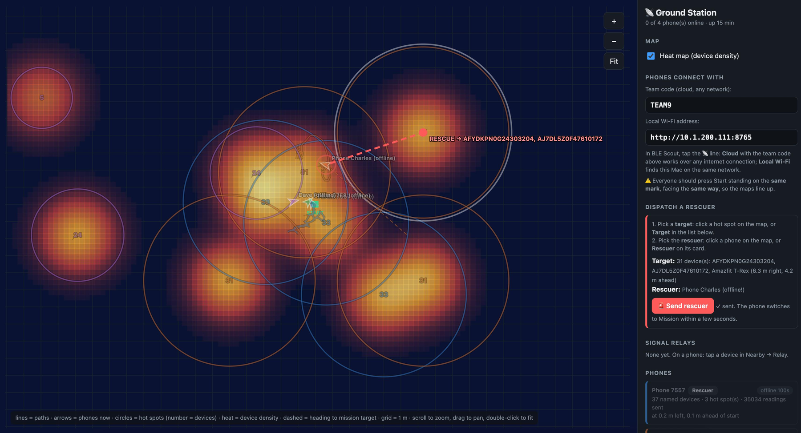
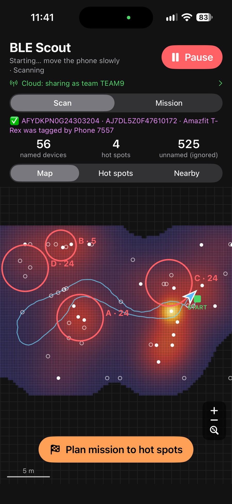
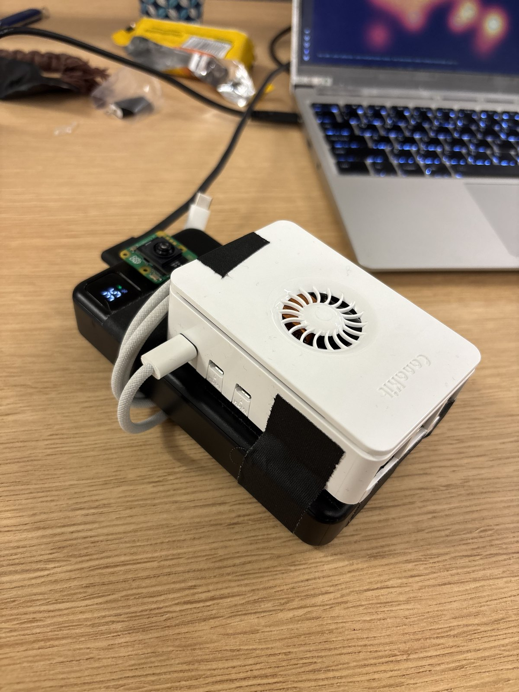
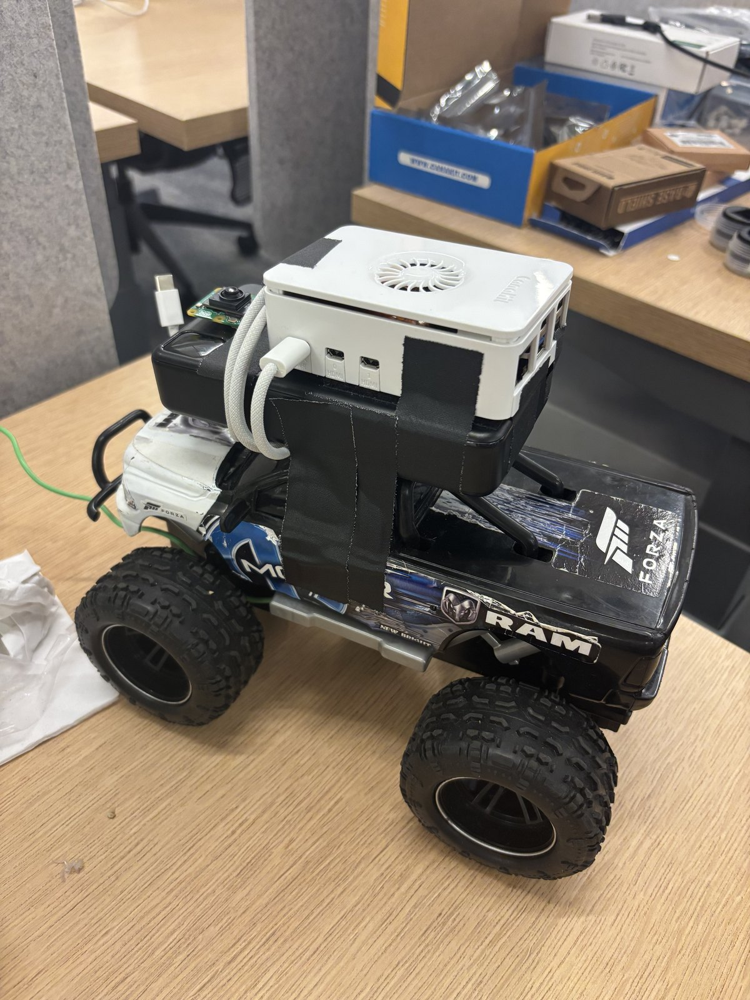

# Team 9: BLE Scout

Search-and-rescue toolkit that turns Bluetooth signals into a live map of where people
probably are. Walk an area and BLE Scout finds **hot spots** — clusters of named Bluetooth
devices — then guides you to the biggest clusters first. The team's laptop shows everyone
on one map and can send a rescuer.

## Ground station

The laptop dashboard: every phone and the Pi on one live map, with paths, hot-spot
rings, a heat-map toggle, signal relay chains and dispatch.

<p align="center">
  
</p>

## iPhone app

The phone app: live hot spots, mission guidance, relay controls and zoomable maps.

<p align="center">
  
</p>

## What's in the repo

| Folder | What it is |
|---|---|
| [`ios/`](ios/) | **BLE Scout iPhone app.** ARKit position tracking, Bluetooth hot spots, mission navigation, spin-to-pinpoint, and signal relay. See the [iOS README](ios/README.md). |
| [`groundstation/`](groundstation/) | **Live team map.** Paths, hot spots, heat map, zoom/pan, relay chains, and dispatch. Works over local Wi-Fi or Supabase. See the [ground station README](groundstation/README.md). |
| [`pi/`](pi/) | **Deployable Raspberry Pi node.** Headless Bluetooth + camera tracking, grid-fit hot spots, and a boot service. See the [Pi README](pi/README.md). |

## Deployable Pi

The same headless uploader runs as a handheld sensor pod or mounted on an RC car.

<p align="center">
  
  &nbsp;&nbsp;
  
</p>

## Quick start

**iPhone app**
- Install **BLE Scout SAR** from TestFlight (ask Evana to add you as a tester), or
- build it: `open ios/BLEScout.xcodeproj` on a Mac with Xcode 16+ and run on a real iPhone.
  The Simulator has no Bluetooth or ARKit.

**Ground station**
```bash
cd groundstation
uv sync
uv run groundstation          # dashboard at http://localhost:8765
```
Phones on the same Wi-Fi find it automatically. For phones on other networks, use the
Supabase team code. Try it without phones:
```bash
uv run python fake_phones.py --phones 3
```

**Deployable Pi**
```bash
cd ~/Team-9
bash pi/install-service.sh    # installs and starts the boot service
```
See [`pi/README.md`](pi/README.md) for the venv, camera, and `.env` setup.

Everyone should press **Start** on the same floor mark, facing the same way, so the maps
line up.

## What's new

- **Steadier hot spots:** 3+ named devices, each heard in 3 separate 5-second windows;
  the dashboard shows hot spots with 5+ signals.
- **Signal relay:** share a device's position with the fleet; other phones can forward it
  or become the rescuer.
- **Dispatch:** the ground station can send a specific phone to a specific hot spot.
- **Zoom and pan** on both the iPhone and ground-station maps.
- **Heat map toggle** in the dashboard, with the map background matched to the heat's low end.
- **Deployable Pi:** camera pose sanity checks, phone-style grid-fit hot spots, and
  automatic start on boot.
- **Named devices by default** (the Pi can opt into unnamed devices with
  `PI_INCLUDE_UNNAMED=1`).

## How it works, briefly

- **Phones** use ARKit for position and CoreBluetooth for readings, then fit a path-loss
  model to place devices and cluster nearby ones into hot spots.
- **The ground station** merges every phone and Pi onto one map, draws paths/hot spots,
  relays and missions, and can dispatch a rescuer.
- **The Pi** does the same headlessly with a Bluetooth scanner and a ceiling-facing AI
  Camera, then uploads over Supabase.
